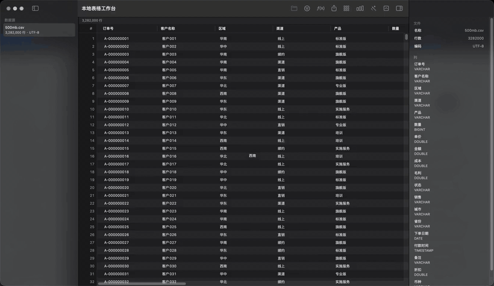

# 本地表格工作台（暂名）

TableWorkbench is a native macOS app for opening huge CSV, Parquet and xlsx files in about two seconds. Built with SwiftUI and DuckDB; your data never leaves the machine.

拖进一个 500MB 的 CSV，两秒左右打开，三百多万行也能滚动，数据不出本机。

## 三个数字

| 指标 | 实测 |
|---|---|
| 打开速度：500MB CSV 首次打开（无缓存） | 2.1–2.4 秒 |
| 包体积：dmg / 解压后的 app | 15 MB / 53 MB |
| 冷启动：双击到窗口出现 | 0.55–0.63 秒 |

首次打开要把 500MB CSV 全量解析一遍，这一步省不掉；解析完会在后台转成 Parquet，之后打开走缓存。同一个文件第二次打开 0.02–0.06 秒，1GB 的文件缓存命中 0.03 秒。两个数字都写在这里，看的人自己判断。

冷启动的四次实测是 0.55 / 0.58 / 0.62 / 0.63 秒，预算 0.6 秒，属于擦线，没过就说没过。

滚动也不卡：1017 万行 × 20 列，每帧布局加绘制中位 1.0 毫秒、p95 1.14 毫秒，60fps 的预算是 16.7 毫秒；另用 ffmpeg 60fps 录屏核对过一遍，没有肉眼可见的停顿。328 万行的第 100 块（深分页）在缓存命中下 0.06 秒。

测试机器：MacBook Pro 18,3（M1 Pro），16GB，macOS 27.0.1，release 构建。

## 支持

- 打开 CSV、TSV、Parquet、xlsx
- 按列排序，条件筛选，AND/OR 组合
- SQL 抽屉，只读查询，表名与列名自动补全
- 一键分析：自动挑维度与度量，一次出 3–5 张图
- 拖拽字段生成透视表
- 分组图表：柱状、条形、折线、饼图，超过 12 组自动合并“其他”
- 列检查器：空值、去重、范围、均值、中位数、直方图
- 导出 CSV / Parquet，Command+C 复制选区为 TSV
- xlsx 多工作表选择
- 菜单栏：打开、导出、关闭文件、运行查询、切换侧栏与检查器

## 不做什么

不做单元格编辑，不做公式，不做仪表盘和多图联动，不做协作，不做云同步。它是分析器，不是表格编辑器。

## 为什么不用 Excel

Excel 打开这种规模的文件要等好几分钟，滚动时还要反复重算。它擅长改数据，不擅长看数据。这个工具只做后者：秒开、随便滚、想查什么写一条 SQL。

## 安装

目前还没有签名的公开版本，dmg 在本地构建后位于 `build/`；正式发布后从 GitHub Releases 下载即可。没有 Developer ID 签名的包会被 Gatekeeper 拦下，第一次需要右键打开。

## 构建

需要 macOS 14+ 和 Swift 6。

    cd app
    swift build
    swift run TableWorkbench

测试：

    cd app
    swift run TableWorkbenchTests

开发用 .app：

    ./scripts/make-app-bundle.sh
    open build/TableWorkbench.app

打包 dmg：

    ./scripts/make-dmg.sh

签名需要 Apple Developer 账号和 Developer ID Application 证书，设置 SIGN_IDENTITY 后脚本会用正式证书重签。

## 已知限制

- xlsx 的公式只读缓存值，缓存值缺失时留空。
- Excel 的日期样式暂按单元格原始值输出，ISO 字符串会正常识别。
- 透视的空组合显示 (空)，空字符串显示 (空白)；CSV 里的空字段会被 DuckDB 当成 NULL。
- 导出有进度提示，但不能取消。
- 没有签名和公证的包会被 Gatekeeper 拦截。

## 许可证

Apache License 2.0，见 [LICENSE](LICENSE)。第三方依赖的许可证登记在 [docs/third-party.md](docs/third-party.md)。

## 参与

提 issue、发 PR 之前先看 [CONTRIBUTING.md](CONTRIBUTING.md)。需求文档在 [docs/requirements](docs/requirements)，改动提案在 [openspec/changes](openspec/changes)；提 PR 时请说明动的是哪个需求编号。
